# RouteAlarm — 목표 도착 시간 기반 스마트 출발 알람

> "몇 시까지 도착하고 싶은지"만 알려주면, 대중교통 상황을 분석해 **언제 일어나야 하는지**를 계산하고 알람을 자동으로 설정·조정하는 Android 앱

Kotlin · Jetpack Compose · Clean Architecture(MVVM) · Hilt · Room · DataStore · WorkManager · AlarmManager

화면은 팀 UI 설계서 v1.1(시안 C "Route Line", 기본 색 오렌지)의 화면 정의(UI-A-001 ~ UI-F-003)를 기준으로 구현했다.

---

## 목차

1. [서비스 소개](#1-서비스-소개)
2. [핵심 기능](#2-핵심-기능)
3. [화면과 스크린샷](#3-화면과-스크린샷)
4. [무료 플랜과 PRO](#4-무료-플랜과-pro)
5. [기술 스택](#5-기술-스택)
6. [아키텍처](#6-아키텍처)
7. [알람 계산 방식](#7-알람-계산-방식)
8. [교통 정보 갱신 방식](#8-교통-정보-갱신-방식)
9. [권한 설명](#9-권한-설명)
10. [프로젝트 구조](#10-프로젝트-구조)
11. [실행 방법](#11-실행-방법)
12. [API 설정 방법](#12-api-설정-방법)
13. [테스트 방법](#13-테스트-방법)
14. [주요 설계 결정](#14-주요-설계-결정)
15. [향후 개선사항](#15-향후-개선사항)

---

## 1. 서비스 소개

일반 알람 앱은 사용자가 직접 "몇 시에 일어날지"를 계산해야 한다. RouteAlarm 은 그 계산을 대신한다.

```
출발지   경기도 남양주시 다산동
도착지   한성대학교
목표 도착 09:00
준비 시간 30분

→ 현재 예상 이동 65분, 안전 여유 10분

목표 도착 09:00
권장 출발 07:45
기상 알람 07:15
```

교통 지연으로 예상 이동시간이 15분 늘어나면 앱이 다시 계산해 알람을 **06:55** 로 앞당긴다
(이동 +15분, 지연이 있을 때 더하는 여유 +5분). PRO 는 알람을 자동으로 옮기고
"교통 상황이 변경되어 알람이 20분 앞당겨졌어요. 07:15 → 06:55" 라고 알려주며,
무료 플랜은 같은 내용을 추천으로 보여주고 **[변경하기]** 를 눌렀을 때 반영한다.

## 2. 핵심 기능

| 기능 | 설명 |
|---|---|
| 자동 알람 계산 | 목표 도착 − 이동시간 − 안전 여유 − 준비시간 = 기상 알람 |
| 노선도형 홈 | 기상 → 출발 → 승차 → 환승 → 도착을 한 줄의 노선으로 보여준다. 노선색은 공식 노선색 고정 |
| 교통 상황 재확인 | PRO: 기상 24h / 3h / 1h / 20분 전에 WorkManager 로 재확인. 무료: 기상 30분 전 1회 |
| 안전한 자동 조정 | 5분 미만 변화는 무시, 30분 초과 변화는 사용자 확인. PRO 는 자동 조정, 무료 플랜과 자동 조정 OFF 는 변경 추천만 |
| 기상 알람 + 출발 알림 | 기상 알람(전체 화면, 알람음, 진동, 5·10분 스누즈)과 "10분 뒤 출발" / "지금 출발" 알림 분리 |
| Offline First | 네트워크 실패 시 Room 캐시 → 마지막 계산값으로 알람 유지, 화면에 안내 띠 표시 |
| 일정 만들기 5단계 | 출발지 → 도착지 → 도착 시각·반복 → 준비 시간 → 여유 시간, 저장 전에 계산 미리보기 |
| 아이폰식 휠 입력 | 도착 시각(오전/오후 · 시 · 분)과 준비 시간(시간 · 분)을 휠을 돌려 고른다. 시 휠이 11과 12 사이를 지나면 오전/오후가 따라 바뀐다 |
| 반복 일정 | 한 번(날짜 선택) / 평일 / 매일 / 요일 직접 선택 |
| 장소 관리 | 화면 안 검색, 즐겨찾기(집/학교/회사), 최근 검색, 현재 위치 출발 |
| 무료 플랜 / PRO | 무료는 일정 2개와 출발 전 교통 확인 1회, PRO 는 일정 무제한과 실시간 재계산 ([4장](#4-무료-플랜과-pro)) |
| 단체 이용권 | 학교·기업이 준 코드를 입력하면 기관·기간을 확인하고 PRO 적용 |
| 컬러 테마 | 기본(오렌지)·새벽·나이트 3종, 모든 플랜에서 선택 가능 |
| 재부팅·시간대 대응 | BOOT_COMPLETED / TIMEZONE_CHANGED 수신 후 알람 복구 |
| 데모 모드 | API 키 없이 Fake 교통 데이터로 전체 흐름 시연, 설정에서 가상 지연·네트워크 오류 주입 |
| 측정 지표 | API 호출/실패/캐시 적중/재계산/자동 조정 횟수를 Room 에 기록, 설정 화면에서 확인 |

## 3. 화면과 스크린샷

| 화면 ID | 화면 | 구현 위치 (`presentation/…`) |
|---|---|---|
| UI-A-001 | 온보딩 3쪽 + 권한 안내 | `onboarding/OnboardingScreen.kt` |
| UI-B-001 | 홈 (내일 경로) | `home/HomeScreen.kt` |
| UI-C-001 ~ 005 | 새 일정 5단계 | `schedule/create/CreateScheduleScreen.kt`, `PlaceStep.kt` (시각·준비 시간 휠은 `core/designsystem/component/Wheel*.kt`) |
| UI-C-006 | 계산 미리보기 | `schedule/create/PreviewStep.kt` |
| UI-D-001 | 알람 목록 | `alarmlist/AlarmListScreen.kt` |
| UI-D-002 | 일정 상세 | `schedule/detail/ScheduleDetailScreen.kt` |
| UI-D-003 | 기상 알람 (전체 화면) | `alarm/service/AlarmRingingActivity.kt` |
| UI-D-004 | 출발·변경 알림 | `alarm/notification/AlarmNotifications.kt` |
| UI-E-001 | PRO 페이월 (개인 / 단체) | `subscription/PaywallSheet.kt` |
| UI-E-002 | 단체 이용권 코드 입력 | `subscription/GroupPassScreen.kt` |
| UI-F-001 | 설정 | `settings/SettingsScreen.kt` |
| UI-F-002 | 테마 선택 | `settings/theme/ThemeScreen.kt` |
| UI-F-003 | 구독 관리 | `subscription/SubscriptionScreen.kt` |

에뮬레이터(Pixel 10 Pro, Android 17)에서 Fake 교통 데이터로 캡처한 화면이다.

| 온보딩 | 홈 | 일정 만들기 (장소) | 도착 시각 (휠) |
|---|---|---|---|
| 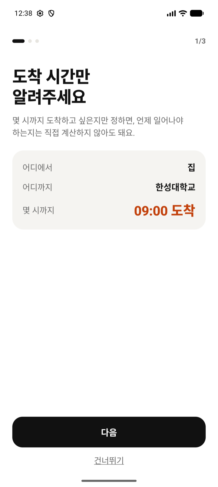 | 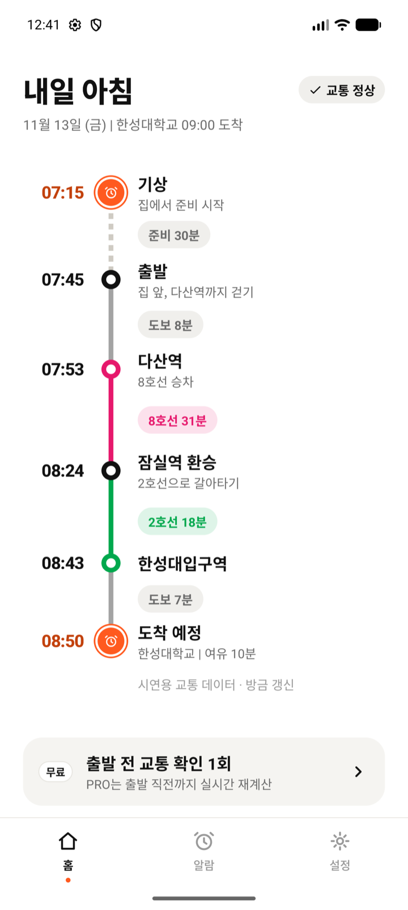 | 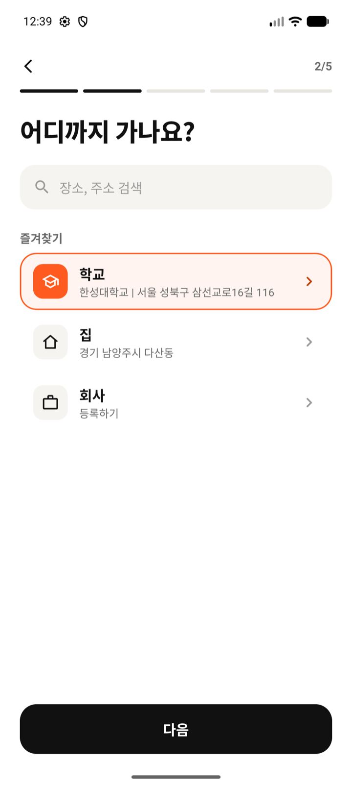 | 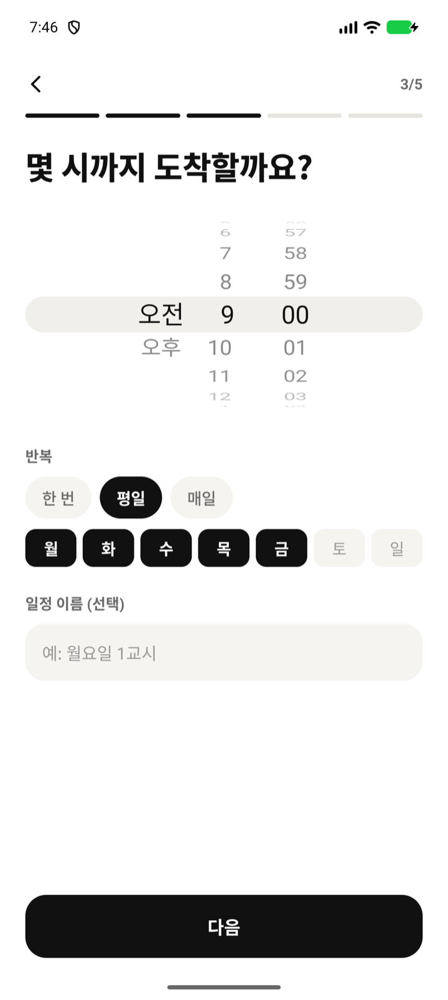 |

| 준비 시간 (휠) | 계산 미리보기 | 알람 목록 | 일정 상세 |
|---|---|---|---|
| 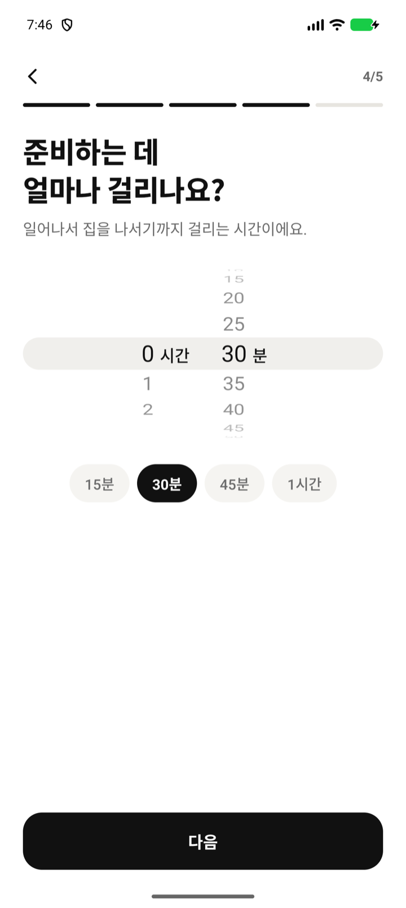 | 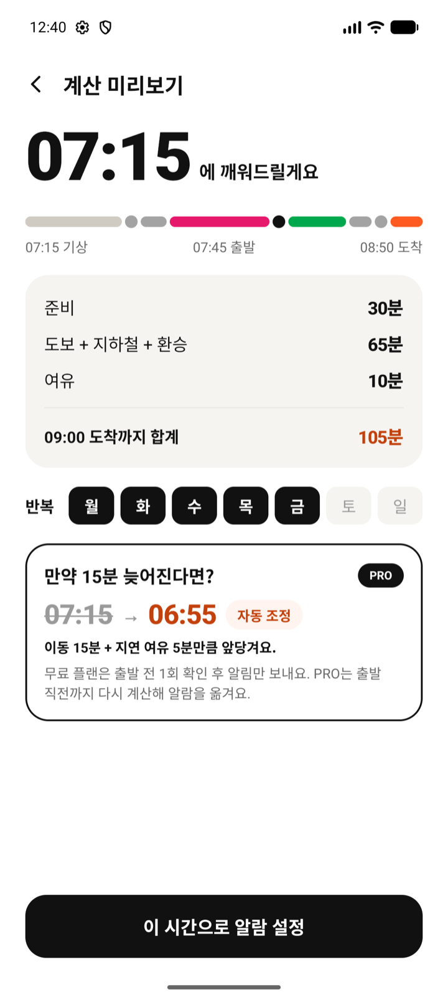 | 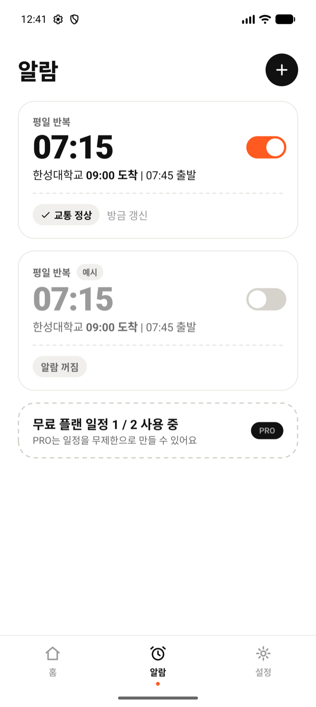 | 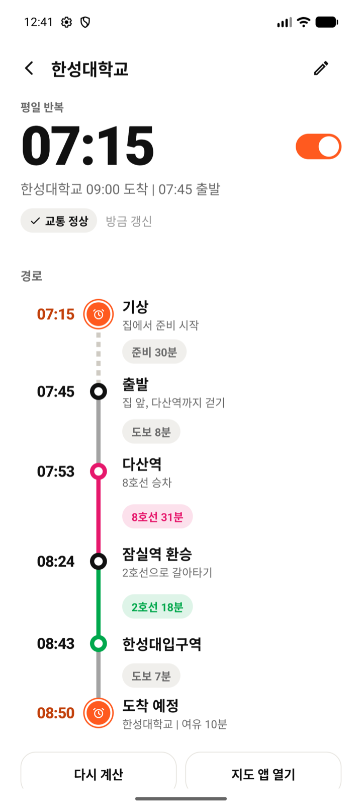 |

| 설정 | 기상 알람 |
|---|---|
| 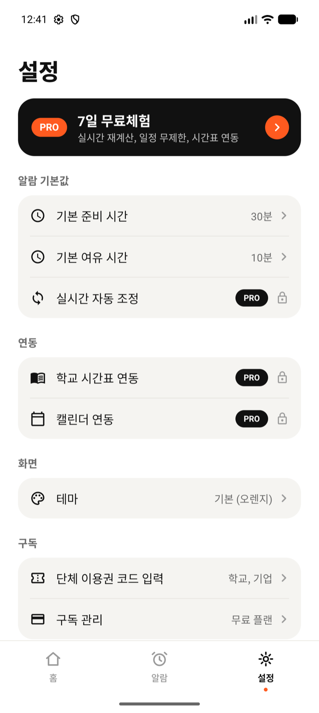 | 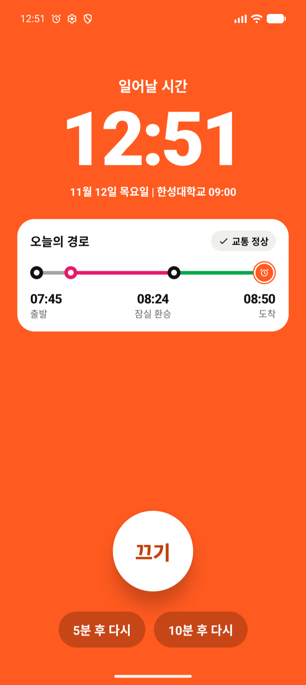 |

| PRO 페이월 | 단체 이용권 | 구독 관리 | 테마 선택 |
|---|---|---|---|
| 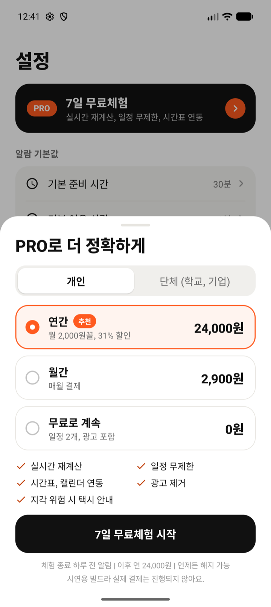 | 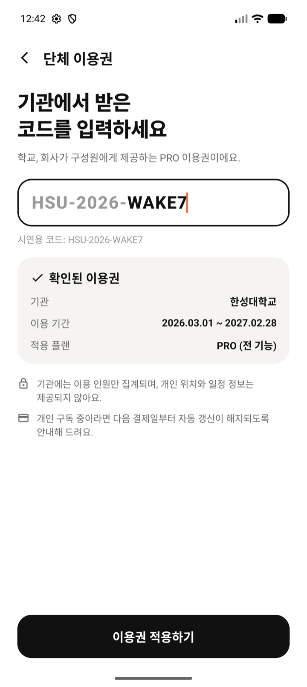 | 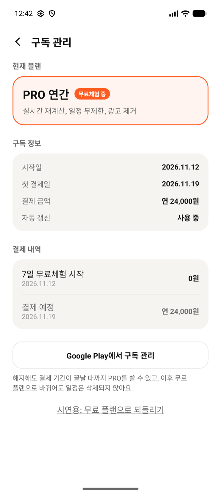 | 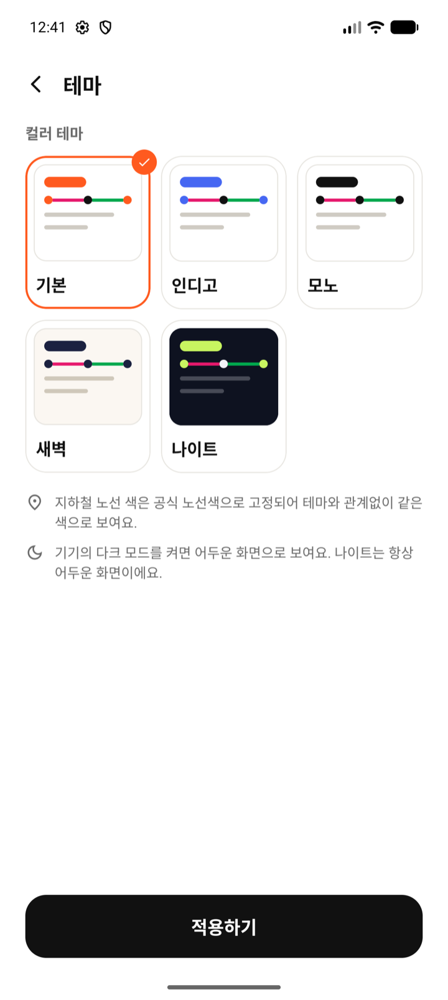 |

| 교통 지연 → 자동 조정 (PRO) | 교통 지연 → 변경 추천 (무료) | 네트워크 실패 → 마지막 계산 기준 |
|---|---|---|
| 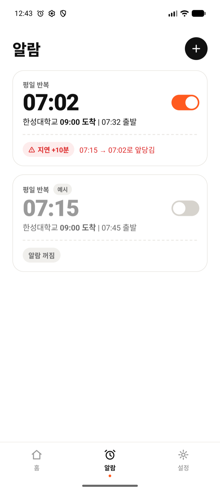 | 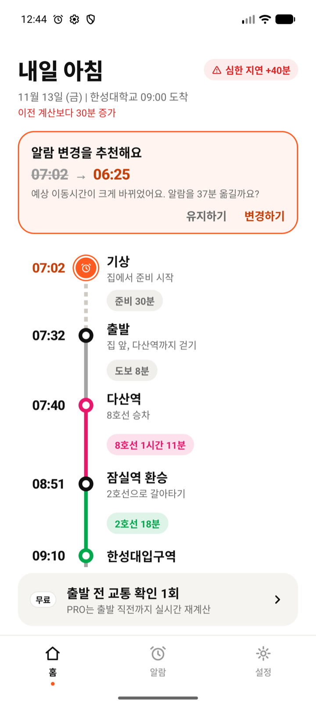 | 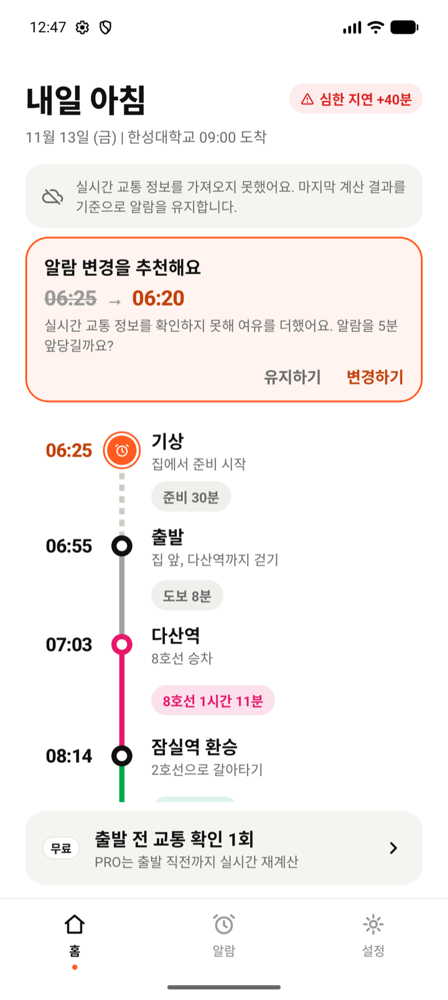 |

## 4. 무료 플랜과 PRO

| | 무료 | PRO (월 2,900원 / 연 24,000원, 7일 무료체험) |
|---|---|---|
| 일정 수 | 2개 (예시 일정은 세지 않음) | 무제한 |
| 교통 재확인 | 기상 30분 전 1회 | 기상 24h / 3h / 1h / 20분 전 |
| 교통이 바뀌었을 때 | 추천 카드와 알림의 **[변경하기]** 로 직접 반영 | 알람 자동 조정 + 알림 |
| 컬러 테마 | 3종 모두 | 3종 모두 |

- 플랜 판단은 화면이 아니라 도메인에서 한다: `CheckScheduleQuotaUseCase`(일정 한도), `RefreshCheckpointPolicy`(재확인 시점), `RefreshTransitTimeUseCase`(자동 조정 여부).
- 일정 한도에 걸리면 하루에 한 번만 페이월을 자동으로 띄우고, 같은 날 다시 누르면 안내 문구만 보여준다.
- **단체 이용권**: 코드 형식을 확인한 뒤 서버에 조회해 기관과 이용 기간을 보여주고 적용한다. 개인 구독 중에 적용하면 이중 결제가 되지 않도록 자동 갱신 해지를 안내한다.
- **결제는 시연용이다.** `SubscriptionRemoteDataSource` 에 `FakeSubscriptionRemoteDataSource` 만 연결되어 있어 실제 결제가 일어나지 않으며, 화면에도 그 사실을 표시한다. 구독 관리 화면의 "시연용: 무료 플랜으로 되돌리기"로 언제든 무료 플랜으로 돌아갈 수 있다.
- 시연용 단체 이용권 코드: `HSU-2026-WAKE7`(한성대학교), `WAKE-2026-TEAM1`, 만료된 코드 `HSU-2025-PAST1`, 인원이 다 찬 코드 `HSU-2026-FULL0`

### UI 설계서와 다르게 구현한 부분

| 항목 | 설계서 v1.1 | 구현 | 이유 |
|---|---|---|---|
| 컬러 테마 | 5종(기본만 무료, 4종은 PRO 잠금) | 기본·새벽·나이트 3종, 모두 무료 | 모든 사용자가 테마를 쓸 수 있도록 잠금을 풀고, 인디고·모노를 빼서 3종으로 줄였다 |
| 화면 모드 | 라이트 / 다크 / 시스템 선택 | 선택 메뉴 없음. 기기의 다크 모드 설정을 따르고 나이트 테마는 항상 어두운 화면 | 테마만 고르도록 단순화했다 |
| "만약 15분 늦어진다면?" | 07:15 → 07:00 | 07:15 → 06:55 | 예시 숫자가 아니라 실제 계산 정책의 결과(이동 +15분, 지연 여유 +5분)를 보여준다 |
| 결제 | Google Play 결제 | 시연용 구현 | Play Console 상품과 영수증 검증 서버가 필요하다 |
| 광고 배너, 시간표·캘린더 연동, 택시 안내 | 제공 | 미구현 (연동 메뉴는 "준비 중"으로 표시) | 외부 SDK·API 연동 범위 |

## 5. 기술 스택

| 분류 | 사용 기술 |
|---|---|
| 언어 | Kotlin 2.2, Coroutines / Flow |
| UI | Jetpack Compose, Material 3, Navigation Compose(타입 안전 라우트), 역할 기반 색 토큰(컬러 테마 3종 × 라이트/다크) |
| 아키텍처 | Clean Architecture, MVVM, UseCase, Repository Pattern |
| DI | Hilt (+ hilt-work, hilt-navigation-compose) |
| 저장 | Room (일정·장소·경로 캐시·알람 이력·지표), Preferences DataStore (사용자 설정·구독 상태·최근 검색) |
| 백그라운드 | WorkManager (교통 재확인), AlarmManager (정확한 알람), Foreground Service (알람 재생) |
| 네트워크 | Retrofit 3, OkHttp, kotlinx.serialization |
| 위치 | FusedLocationProviderClient (1회 조회만) |
| 테스트 | JUnit4, kotlinx-coroutines-test, Fake Repository |
| 빌드 | AGP 8.13, Gradle 9.2, KSP, Version Catalog |

## 6. 아키텍처

```
┌──────────────────────── presentation ────────────────────────┐
│ Compose Screen (Stateless)  ←  ViewModel (StateFlow<UiState>) │
└──────────────────────────────┬───────────────────────────────┘
                               │ UseCase 호출
┌──────────────────────────── domain ──────────────────────────┐
│ model (Schedule, AlarmPlan, TransitRoute …)                  │
│ usecase (BuildAlarmPlan, RefreshTransitTime, ScheduleAlarm …)│
│ repository 인터페이스, policy (AdjustmentPolicy …)            │
│   ※ Android 의존성 없음 → JVM 단위 테스트                     │
└──────────────────────────────┬───────────────────────────────┘
                               │ 인터페이스 구현
┌───────────────────────────── data ───────────────────────────┐
│ repository 구현 (Offline First)                               │
│ local: Room DAO, DataStore     remote: Fake / Proxy DataSource│
│ (교통·장소·구독 각각 RemoteDataSource 인터페이스로 교체 가능) │
│ mapper: DTO·Entity ↔ Domain                                   │
└──────────────────────────────────────────────────────────────┘
┌───────────────────────────── alarm ──────────────────────────┐
│ AndroidAlarmScheduler(AlarmManager) · TransitRefreshWorker    │
│ AlarmReceiver · BootReceiver · AlarmService · Notifications   │
└──────────────────────────────────────────────────────────────┘
```

- UI 는 Retrofit/Room 을 직접 알지 못한다. `UI → ViewModel → UseCase → Repository 인터페이스 → 구현 → DataSource`.
- Repository 는 예외를 UI 로 던지지 않고 `AppResult<T>` / `AppError` 로 변환한다.
- AlarmManager·WorkManager·Notification 도 `AlarmScheduler`, `TransitRefreshScheduler`, `AlarmNotifier` 인터페이스 뒤에 숨겨 UseCase 를 JVM 에서 테스트한다.

## 7. 알람 계산 방식

`domain/usecase/BuildAlarmPlanUseCase.kt` 가 아래 UseCase 를 순서대로 조립한다.

```
travel    = EstimateTravelTime(현재 ETA, 최근 실시간 이동시간 n개)
            → max(현재, 0.7·현재 + 0.3·평균), 분 단위 올림
buffer    = CalculateSafetyBuffer(기본 여유, 지연, 실시간 여부)
            → 기본 + min(ceil(지연·0.3), 10) + (캐시 데이터면 +5)
departure = CalculateDepartureTime: target − travel − buffer
wakeUp    = CalculateWakeUpTime:   departure − preparation
```

- 모든 계산은 `Instant`(절대 시각) 위에서 한다. DST 전환일에 벽시계 시간으로 빼면 1시간 오차가 나기 때문이다.
- 권장 출발 시각이 이미 지났으면 "지금 출발" 기준으로 다시 계산해 `PlanOutcome.TooLate`(예상 도착·지각 분) 를 돌려준다.
- 반복 일정의 다음 회차는 `ResolveNextOccurrenceUseCase` 가 결정한다. 오늘 회차의 마지막 이벤트(출발 알림 또는 기상 알람)가 지나야 다음 회차로 넘어간다.

### 알람 조정 정책 (`domain/policy/AdjustmentPolicy.kt`)

| 변화량 | 동작 |
|---|---|
| 앞당김 < 5분 / 늦춤 < 10분 | 알람 유지 (ETA 노이즈 무시, 늦추는 쪽은 더 보수적) |
| 5~30분 | PRO: 자동 조정 + 알림. 무료 플랜이거나 자동 조정 OFF: 추천 카드와 알림의 [변경하기] |
| > 30분 | 사용자 확인 요청. 단 알람 1시간 이내로 남아 확인이 불가능하면 "앞당기기"만 자동 반영 (무료 플랜은 이때도 확인만 요청) |

## 8. 교통 정보 갱신 방식

```
일정 저장/활성화 ──▶ 즉시 1회 조회
                     │
                     ▼ ScheduleAlarmUseCase 가 다음 체크포인트 예약
        PRO : 기상 알람 24h 전 ──▶ 3h 전 ──▶ 1h 전 ──▶ 20분 전
        무료: 기상 알람 30분 전 1회                         (WorkManager, 네트워크 필요)
                     │
                     ▼ 각 체크포인트마다 RefreshTransitTimeUseCase
        경로 조회 → 새 계획 계산 → 조정 정책 판단 → Room 저장 → AlarmManager 재등록 → 알림
```

- WorkManager 는 정확한 시각을 보장하지 않으므로 "대략 그 즈음 재확인"만 담당하고, **실제 알람은 AlarmManager** 가 담당한다.
- 일정당 하루 최대 4회(무료 플랜은 1회)만 서버를 호출한다. 몇 분마다 폴링하지 않는다.
- 플랜이 바뀌면(체험 시작, 단체 이용권 적용, 무료 전환) `RestoreAlarmsUseCase` 로 체크포인트를 새 플랜 기준으로 다시 잡는다.
- 네트워크 실패 시: Room 경로 캐시(24h) → 그마저 없으면 마지막 계산값으로 알람 유지 + `isRealtime=false`. 홈과 상세에 "실시간 교통 정보를 가져오지 못했어요…" 안내 띠를 보여준다. Worker 는 백오프로 최대 3회 재시도.
- 재부팅/시간대 변경: `BootReceiver` → `RestoreAlarmsUseCase` 가 네트워크 없이 Room 의 마지막 이동시간으로 즉시 알람을 복구하고, 실시간 갱신은 다음 체크포인트에 맡긴다.

## 9. 권한 설명

| 권한 | 용도 | 없을 때 |
|---|---|---|
| `POST_NOTIFICATIONS` (13+) | 기상 알람 Foreground 알림, 출발/교통 변경 알림 | 알림 없이 알람 화면만 표시, 설정 화면에서 상태 안내 |
| `USE_EXACT_ALARM` (13+) / `SCHEDULE_EXACT_ALARM` (12) | 계산된 시각에 정확히 울리기 위해 | 출발 알림은 근사 알람으로 대체하고 사용자에게 안내 |
| `ACCESS_COARSE/FINE_LOCATION` | "현재 위치에서 출발" 선택 시 **조회 순간 1회** | 주소 검색으로 출발지 지정 |
| `RECEIVE_BOOT_COMPLETED` | 재부팅 후 알람 복구 | — |
| `USE_FULL_SCREEN_INTENT` | 잠금화면 위 알람 화면 | — |
| `FOREGROUND_SERVICE(_MEDIA_PLAYBACK)` | 알람음 재생 | — |

권한을 요청하기 전에 온보딩 마지막 쪽에서 **왜 필요한지**(알림·정확한 알람은 필수, 위치는 선택) 먼저 설명하고, 알림 → 정확한 알람 → 위치 순서로 요청한다. 거부해도 앱은 크래시 없이 동작하며 설정 화면에서 권한 상태를 확인할 수 있다.

## 10. 프로젝트 구조

```
app/src/main/java/com/example/routealarm
├── core
│   ├── common        AppResult / AppError / Dispatcher Qualifier
│   ├── designsystem  theme(AppColors 색 토큰, 컬러 테마 3종, Typography, Shapes)
│   │                 component(RouteLine 노선도, 아이폰식 휠 선택기, 버튼·카드·칩·시트 등 공통 컴포넌트)
│   └── util          TimeProvider, Duration 확장, 한글 줄바꿈 보정
├── domain            (Android 의존성 없음)
│   ├── model         Schedule, AlarmPlan, Place, TransitRoute, UserPreferences, Subscription …
│   ├── policy        AdjustmentPolicy, BufferPolicy, RefreshCheckpointPolicy
│   ├── repository    인터페이스 (TransitRepository, AlarmScheduler …)
│   └── usecase       계산·갱신·알람 등록·일정 관리·구독(체험, 단체 이용권, 일정 한도) UseCase
├── data
│   ├── local/db      Room Entity, DAO, Database
│   ├── local/datastore  Preferences DataStore
│   ├── remote        Transit / PlaceSearch / Subscription RemoteDataSource 인터페이스, dto, fake/, proxy/
│   ├── mapper        DTO·Entity ↔ Domain
│   ├── repository    Offline First 구현체
│   └── location      FusedLocationRepository
├── alarm
│   ├── scheduler     AndroidAlarmScheduler (AlarmManager)
│   ├── worker        TransitRefreshWorker (WorkManager)
│   ├── receiver      AlarmReceiver, BootReceiver
│   ├── service       AlarmService (Foreground), AlarmRingingActivity
│   └── notification  채널·알림 생성
├── presentation
│   ├── navigation    Route(타입 안전), RouteAlarmApp(NavHost + BottomBar)
│   ├── onboarding / home / alarmlist / schedule(create, detail)
│   ├── settings(theme) / subscription(페이월, 단체 이용권, 구독 관리) / permission
│   └── common        노선도 화면 모델(RouteTimeline), 노선색, 시간 포맷, 오류 메시지 매핑
└── di                Hilt 모듈 (App, Data, Network, Alarm)

app/src/test/java/com/example/routealarm
├── fake              Fake Repository / Scheduler / Notifier
├── core              휠 선택기 계산 규칙과 움직임 단위 테스트
├── domain            계산·정책·갱신·구독 시나리오 단위 테스트
└── presentation      노선도 화면 모델 단위 테스트
```

## 11. 실행 방법

1. Android Studio (Ladybug 이상, AGP 8.13 지원) 로 폴더를 연다.
2. `local.properties.example` 을 `local.properties` 로 복사하고 `sdk.dir` 을 맞춘다. (Android Studio 가 자동으로 만들어 주기도 한다)
3. 그대로 실행하면 **fake** 제공자로 동작한다. API 키 없이 모든 기능을 사용할 수 있다.

```bash
./gradlew assembleDebug
./gradlew installDebug
```

- minSdk 26 / targetSdk 36 / JDK 17 이상
- 처음 실행하면 온보딩 3쪽(마지막 쪽에서 권한 안내) → 홈에 "집 → 한성대학교" 예시 일정이 꺼진 상태로 표시된다.

### 데모 시나리오 (API 키 없이)

1. 알람 탭의 **+** 로 일정을 만든다(출발지 "집", 도착지 "학교" 즐겨찾기를 쓰면 설계서 예시와 같은 07:15 기상이 나온다).
2. 설정 > 데모 > **가상 교통 지연** 을 15분으로 올리고 **지금 교통 정보 다시 확인** 을 누른다.
3. 무료 플랜: 홈에 "알람 변경을 추천해요 07:15 → 06:55" 카드가 뜨고 **[변경하기]** 를 누르면 알람이 옮겨진다.
4. 설정 맨 위 PRO 배너 > **7일 무료체험 시작**(시연용, 결제 없음) 후 지연을 바꿔 다시 확인하면 추천 대신 알람이 자동으로 옮겨지고, 알람 목록에 "07:15 → 07:02로 앞당김"처럼 변경 내역이 표시된다.
5. 설정 > **단체 이용권 코드 입력** 에 `HSU-2026-WAKE7` 을 넣으면 기관·기간이 확인되고 PRO 가 적용된다.
6. **네트워크 오류 시뮬레이션** 을 켜고 다시 확인하면 홈에 오프라인 안내 띠가 표시되고 알람은 유지된다.
7. 설정 > 테마에서 컬러 테마를 바꿔 본다. **기상 알람 미리 울려보기** 로 알람 화면도 바로 확인할 수 있다.

## 12. API 설정 방법

실제 교통 API 는 **Backend Proxy** 를 통해 사용한다. 앱에는 어떤 Secret 도 들어가지 않는다.

```properties
# local.properties (git 에 커밋되지 않음)
routealarm.transitProvider=proxy
routealarm.proxyBaseUrl=https://your-proxy.example.com/
```

Proxy 가 구현해야 하는 응답 형식은 [docs/proxy-api.md](docs/proxy-api.md) 에 있다.
ODsay·TMAP·공공데이터 등 어떤 제공자를 쓰든 Proxy 에서 이 형식으로 정규화하면 앱 코드는 바뀌지 않는다.

제공자를 앱 안에서 직접 구현하고 싶다면 `TransitRemoteDataSource` 를 구현하고 `di/NetworkModule.kt` 에서 바인딩만 바꾸면 된다.

## 13. 테스트 방법

```bash
./gradlew testDebugUnitTest
```

도메인 계층과 화면 모델, 휠 선택기의 계산 규칙과 움직임은 Android 의존성이 없어 JVM 에서 바로 실행된다. 현재 127개 테스트:

| 테스트 | 검증 내용 |
|---|---|
| `BuildAlarmPlanUseCaseTest` | 09:00/60분/10분/30분 → 07:20, 자정 넘김, 다음날, DST, 이동 0분, 음수 입력, 과거 목표, 지각(TooLate), 캐시 데이터 여유 |
| `CalculationUseCasesTest` | 여유시간 계산, 이동시간 안정화(가중 평균·올림), 출발/기상 계산 |
| `EvaluateAlarmAdjustmentUseCaseTest` | 5분 미만 유지, 5분 이상 자동, 늦춤 10분 기준, 30분 초과 확인, 자동 조정 OFF, 알람 직전 예외 |
| `ResolveNextOccurrenceUseCaseTest` | 반복 요일의 다음 회차, 1회 일정 날짜 결정 |
| `RefreshCheckpointPolicyTest` | PRO 24h/3h/1h/20분 체크포인트 선택, 무료 플랜 30분 전 1회 |
| `RefreshTransitTimeUseCaseTest` | 교통 지연 → 자동 조정·알림, 작은 변화 유지, 추천/확인 요청, 추천 승인, 네트워크 실패 폴백, 알람 직전 즉시 울림, 이미 울린 알람은 변경하지 않음, 무료 플랜은 자동 조정 대신 추천 |
| `SyncScheduleUseCaseTest` | 재부팅 복구, 회차 넘김, 1회 일정 종료, 시간대 변경, 정확한 알람 권한 없음, 스누즈 보존 |
| `SubscriptionUseCasesTest` | 연간 요금(월 2,000원꼴·31% 할인), 무료 일정 한도(예시 일정 제외), 체험 시작과 재확인 재예약, 구독 종료 후 무료 전환, 단체 이용권 코드 정규화·형식 검사·확인·적용, 개인 구독 중 적용 시 해지 안내, 검증 서버 연결 실패 시 플랜 유지 |
| `PreviewDelayScenarioUseCaseTest` | "만약 15분 늦어진다면?" 카드: 이동 +15분·지연 여유 +5분, 실제 재계산과 같은 시각, 지연이 없으면 그대로 |
| `RouteTimelineBuilderTest` | 설계서 예시 경로의 지점·시각·구간, 승차 대기 시간 반영, 걷지 않고 바로 타는 경로, 경로 정보가 없는 계획, 방향 조사(로/으로) |
| `WheelMathTest` | 고리 휠의 칸 번호, 12시간제 숫자와 오전/오후(11↔12 전환, 자정·정오), 분이 시를 바꾸지 않음, 시간·분 길이 변환, 내가 알린 값과 바깥에서 온 값 구분, 손을 뗀 뒤 멈출 칸과 관성 거리 조정, 원통 모양(칸 위치·크기·진하기)과 누른 칸 찾기 |
| `WheelStateTest` | 휠의 움직임을 프레임 단위로 검증: 끌기 방향과 끝 저항, 튕긴 뒤 미리 정한 칸에 정확히 멈춤, 도는 휠을 잡아 멈추기, 잡고 있는 휠은 옮기지 않음, 바깥 값이 관성보다 우선, 취소된 움직임이 칸 사이에 남는 경우, 도는 도중의 오전/오후 전환 |

리포트: `app/build/reports/tests/testDebugUnitTest/index.html`

## 14. 주요 설계 결정

각 결정의 이유는 해당 소스의 KDoc 에도 적혀 있다.

| 결정 | 이유 |
|---|---|
| **Schedule 을 중심 개념으로, 알람 시각은 계산 결과(AlarmPlan)** | 나중에 시간표/캘린더 연동 시 Schedule 만 만들면 계산·알람·갱신 파이프라인을 재사용 (`domain/model/Schedule.kt`) |
| **Fake 를 Repository 가 아니라 RemoteDataSource 레벨에 둠** | 시연 중에도 DTO 매핑·캐시·오프라인 폴백 코드가 실제와 똑같이 동작하고 검증됨 (`data/remote/fake`) |
| **Instant 기반 계산, 표시만 ZoneId 변환** | DST/시간대 변경 시 벽시계 계산 오차 방지 (`CalculateDepartureTimeUseCase`) |
| **TimeProvider.zone() 을 매번 읽음** | `Clock.systemDefaultZone()` 은 생성 시점 Zone 을 붙잡아 여행 중 시간대 변경을 놓침 (`core/util/TimeProvider.kt`) |
| **비대칭 히스테리시스** | 앞당김은 5분, 늦춤은 10분부터 반영. 늦잠 위험 쪽을 더 보수적으로 (`AdjustmentPolicy`) |
| **30분 초과는 자동 변경 금지, 단 알람 직전은 예외** | API 오류 가능성 vs 사용자가 자고 있어 확인 불가 → 지각 방지 우선 (`EvaluateAlarmAdjustmentUseCase`) |
| **이미 울린 기상 알람은 재계산해도 바꾸지 않음** | 사용자는 이미 깨어 있으므로 예상 도착만 갱신. 울리기 전이라면 "지금 당장" 알람으로 당긴다 (`RefreshTransitTimeUseCase`) |
| **캐시 경로로 계산한 조정은 다른 문구로 알림** | "혼잡해요"가 아니라 "실시간 정보를 못 가져와 여유를 더했어요"로 원인을 정확히 전달 (`AlarmNotifications`) |
| **이동시간은 현재 ETA 보다 짧아지지 않게 블렌딩** | 우연히 짧게 나온 ETA 하나로 알람이 늦어지는 것을 방지 (`EstimateTravelTimeUseCase`) |
| **일정의 장소는 FK 가 아닌 스냅샷** | 즐겨찾기 삭제/수정이 이미 설정된 알람을 조용히 바꾸지 않도록 (`ScheduleEntity`) |
| **setAlarmClock 으로 기상 알람 등록** | Doze 에서도 정확, 상태바 알람 아이콘, 13+ 에서 USE_EXACT_ALARM 으로 권한 프롬프트 불필요 (`AndroidAlarmScheduler`) |
| **알람 재생은 Foreground Service, 화면은 상태만 표시** | 화면이 꺼지거나 Activity 가 종료돼도 알람이 계속 울려야 함 (`AlarmService`) |
| **WorkManager 는 재확인만, AlarmManager 가 실제 알람** | WorkManager 는 실행 시각을 보장하지 않음 (`TransitRefreshWorker`) |
| **ScheduleAlarmUseCase 는 멱등(취소 후 재등록)** | 재부팅·재계산·시간대 변경 어디서든 안심하고 호출 가능 |
| **채널 3개 분리 (알람/출발/교통)** | 사용자가 교통 알림만 끄고 기상 알람은 유지할 수 있도록 |
| **좌표 캐시 키를 100m 단위로 반올림** | 정확한 위치를 저장하지 않으면서 현재 위치 흔들림에도 캐시 재사용 |
| **API Secret 은 Backend Proxy 에만** | APK 디컴파일 유출 방지 (`docs/proxy-api.md`) |
| **Dynamic Color 미사용** | 사용자가 고른 컬러 테마가 기기 배경화면에 따라 바뀌면 안 됨 (`core/designsystem/theme/Color.kt`) |
| **색은 역할 기반 토큰(AppColors)으로만 사용** | 컬러 테마를 바꿀 때 토큰 묶음만 교체하면 앱 전체에 반영됨. 노선색·상태색 같은 정보 색은 테마와 분리해 고정 |
| **플랜에 따른 차이는 도메인에서 판단** | 화면마다 PRO 여부를 따로 검사하면 빠뜨리기 쉬움. 일정 한도·재확인 시점·자동 조정을 UseCase/Policy 가 결정 (`SubscriptionUseCases.kt`, `RefreshCheckpointPolicy`) |
| **결제·이용권 검증도 RemoteDataSource 교체 지점으로 분리** | 실제 Play Billing + 영수증 검증 서버를 붙일 때 구현체만 바꾸면 됨. 시연 중임을 `isSimulated` 로 화면에 표시 (`SubscriptionRemoteDataSource`) |
| **휠 선택기는 위치값 하나와 끌기 제스처로 직접 구현** | 고리처럼 끝없이 돌고, 원통 모양으로 그리고, 멈출 칸을 미리 정하려면 스크롤 목록보다 위치(가운데 칸 번호) 하나를 직접 움직이는 편이 단순하다. 끌기를 휠이 모두 가져가므로 스크롤 화면 안에서도 화면이 따라 움직이지 않는다 (`Wheel.kt`) |
| **시 휠은 24칸 고리, 오전/오후는 거기서 계산** | 12시간제 숫자를 두 번 반복해 보여주면 11↔12 를 지날 때 오전/오후가 저절로 바뀌고, 빠르게 돌려도 숫자와 오전/오후가 어긋날 수 없다 (`WheelMath.kt`) |
| **휠에서 손을 떼는 순간 멈출 칸을 정해 값을 알림** | 관성으로 도는 동안 다음 단계로 넘어가도 고른 값이 반영된다. 멈출 때까지 기다리면 그 사이의 값을 잃을 수 있다 (`WheelState.targetIndex`) |
| **입력 중인 글자는 Compose 상태로 두고 입력값을 바꿔 끼우지 않음** | StateFlow 를 거치거나 입력 도중 대문자로 바꾸면 빠르게 칠 때 글자가 빠짐. 대문자 변환은 표시와 서버 확인 단계에서만 (`GroupPassViewModel`) |

## 15. 향후 개선사항

- [ ] 실제 Backend Proxy 서버 구현 (ODsay/TMAP 정규화)
- [ ] Google Play Billing 연동과 영수증 검증 서버, 단체 이용권 발급·관리
- [ ] 무료 플랜 배너 광고, 지각 위험 시 택시·공유 모빌리티 안내
- [ ] 상세 화면 지도(경로 폴리라인) 표시
- [ ] 대학교 시간표 / Google Calendar 가져오기 → Schedule 자동 생성 (현재 설정의 연동 메뉴는 "준비 중")
- [ ] 알람 이력 기반 개인화 (요일·시간대별 평균 이동시간, 사용자의 실제 출발 지연 학습)
- [ ] 서버 기반 실시간 모니터링 + FCM 푸시로 WorkManager 체크포인트 사이의 급격한 변화 대응
- [ ] Compose UI 테스트, Room DAO 계측 테스트, WorkManager `TestListenableWorkerBuilder` 테스트
- [ ] Room Migration 작성 (현재는 포트폴리오 범위라 destructive migration)
- [ ] 알람 변경 Undo, 위젯, Wear OS

---

이 프로젝트는 대학 프로젝트이자 Android 개발 포트폴리오로 제작되었다.
